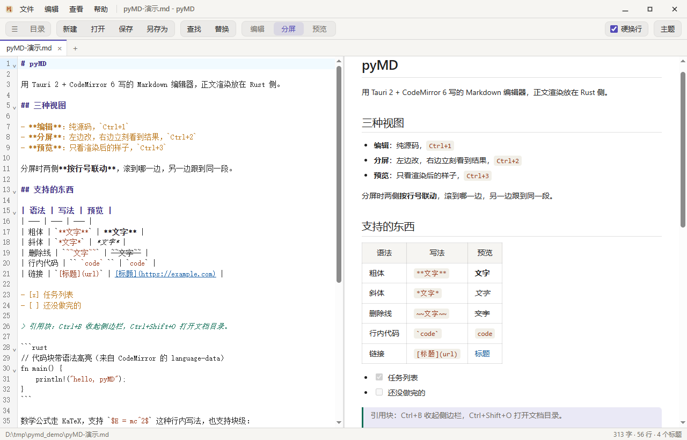
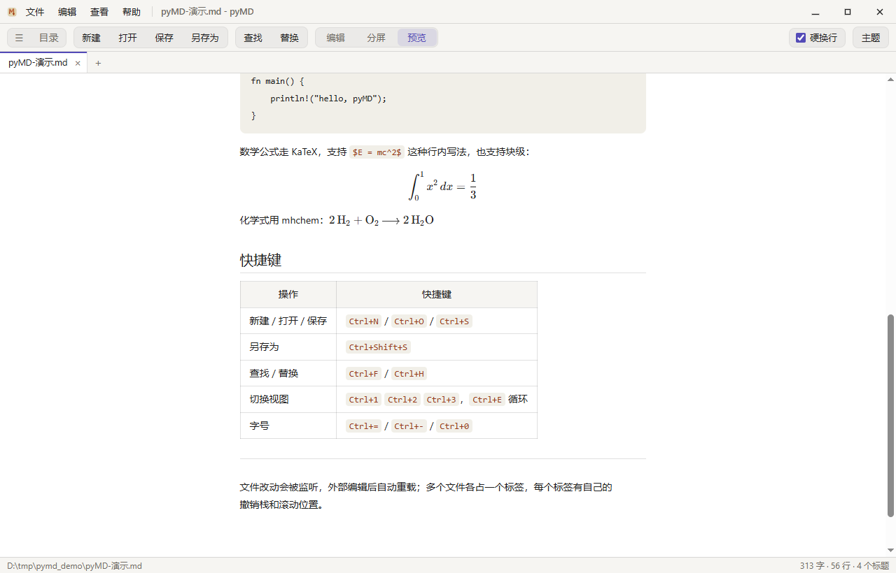
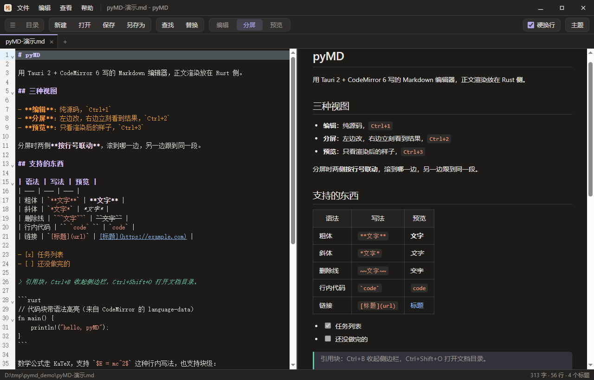

# pyMD

**用 Tauri 2 + CodeMirror 6 写的 Markdown 编辑器**：单文件约 6.8 MB，Markdown 渲染、目录提取、文件读写、文件监听全部在 Rust 侧完成，前端只负责编辑和显示。

<p>
  
  
  
  
</p>



---

## 特性

**编辑**

- 三种视图：纯源码 / 左右分屏 / 纯预览，`Ctrl+1` `Ctrl+2` `Ctrl+3`，`Ctrl+E` 循环
- 分屏两侧**按行号双向联动**——编辑区滚到第 N 行，预览顶部就是第 N 行那一块，反过来也一样
- 多文件标签页：每个标签独立的缓冲、撤销栈、选区和滚动位置；重启后恢复上次打开的已保存文件
- 查找替换（`Ctrl+F` / `Ctrl+H`）：全部匹配高亮，当前项加描边，替换后报数
- 字号 12–22 px 缩放，编辑器与预览同步
- **整页缩放** 50%–300%：工具栏、侧边栏、状态栏一起变，等同浏览器的 `Ctrl+滚轮`；和字号缩放互不干扰，状态栏只在非 100% 时露出倍率（点一下复位）
- 段内单个换行是否算换行，可用工具栏的**硬换行**勾选框切换（[见下](#关于硬换行)）

**渲染**

- comrak 走 CommonMark + GFM：表格、任务列表、删除线、自动链接、脚注、`> [!NOTE]` 提示块
- 数学公式 KaTeX，支持 `$...$`、`$$...$$`、`\(...\)`、`\[...\]` 和 ` ```math ` 围栏
- 化学式 mhchem：`$\ce{2H2 + O2 -> 2H2O}$`
- **公式转图**：工具栏勾上「公式转图」，预览里的公式会变成 PNG 图片。KaTeX 的排版依赖自带字体，复制到 Word / 微信 / 邮件里字体一丢就散架；图片走哪都认。默认关（矢量最清晰），勾选状态记在本地
- 右侧文档目录（H1–H6）：点击跳转，光标移动时自动高亮当前章节

**文件**

- 打开 / 保存 / 另存为，`.md` / `.markdown` / `.mdx` / `.txt`
- **导出纯文本**：编辑菜单的「复制为纯文本」把标记全去掉再进剪贴板（有选区就只转选区），文件菜单的「导出为纯文本 (.txt)」另存一份无格式副本
- 拖文件进窗口直接打开，可一次拖多个
- 外部修改自动重载（有未保存改动时只提示、不覆盖）
- 左侧边栏：当前目录的 Markdown 列表 + 最近打开；文件多时整栏滚动，长文件名省略

**界面**

- 自绘标题栏（无系统边框）：应用图标 + 文件/编辑/查看/帮助 + 文件名 + 最小化/最大化/关闭
- 工具栏按功能分成几块浅色胶囊：`☰ 目录`｜文件操作｜`查找 替换`｜视图切换｜右端 `硬换行` / `公式转图` / `主题`
- 明暗两套主题，跟随系统或手动切换
- 关于页含版本号、作者、邮箱（一键复制，不生成 `mailto:`）

## 截图

| 预览（代码高亮 + 公式） | 深色主题 |
| --- | --- |
|  |  |

## 运行

Windows 10 / 11，需要 **WebView2 运行时**（Win11 自带，Win10 多半也随 Edge 装好了）。

- **直接跑**：从 [Releases](https://github.com/shiefzhang/PyMD/releases) 下载 `pymd.exe`，双击即可。单个 exe 自包含——CRT 静态链接、前端资源内嵌、不需要 `WebView2Loader.dll`，拷到别的机器上也能开。
- **从源码构建**：见下文。

## 快捷键

| 操作 | 快捷键 |
| --- | --- |
| 新建标签 / 打开 / 保存 / 另存为 | `Ctrl+N` / `Ctrl+O` / `Ctrl+S` / `Ctrl+Shift+S` |
| 关闭标签 | `Ctrl+W` |
| 切换标签 | `Ctrl+Tab` |
| 撤销 / 重做 | `Ctrl+Z` / `Ctrl+Y` |
| 剪切 / 复制 / 粘贴 / 全选 | `Ctrl+X` / `Ctrl+C` / `Ctrl+V` / `Ctrl+A` |
| 查找 / 替换 | `Ctrl+F` / `Ctrl+H`（`Enter` 下一个，`Esc` 关闭） |
| 文本 / 分屏 / 预览 | `Ctrl+1` / `Ctrl+2` / `Ctrl+3`，`Ctrl+E` 循环 |
| 侧边栏 / 文档目录 | `Ctrl+B` / `Ctrl+Shift+O` |
| 放大 / 缩小 / 重置字号 | `Ctrl+=` / `Ctrl+-` / `Ctrl+0` |
| 放大 / 缩小 / 重置整页 | `Ctrl+Shift+=` / `Ctrl+Shift+-` / `Ctrl+Shift+0`，或 `Ctrl+滚轮` |

## 从源码构建

### 1. 前置

**Microsoft C++ Build Tools**（MSVC 链接器）：<https://visualstudio.microsoft.com/visual-cpp-build-tools/>
安装时勾选「使用 C++ 的桌面开发」。也可以用 winget（需要管理员终端）：

```powershell
winget install --id Microsoft.VisualStudio.2022.BuildTools `
  --override "--quiet --add Microsoft.VisualStudio.Workload.VCTools --includeRecommended"
```

**Rust**：<https://rustup.rs> → 默认的 `x86_64-pc-windows-msvc` 工具链。

### 2. 装依赖、跑起来

```bash
npm install
npm run tauri dev
```

### 3. 出可执行文件

```bash
npm run build          # 前端：tsc --noEmit + vite build → dist/
cd src-tauri
cargo build --release --features custom-protocol
```

产物在 `src-tauri/target/release/pymd.exe`。嫌 `target` 占 C 盘，可以在 `src-tauri/.cargo/config.toml` 里写 `[build] target-dir = "D:/…"`，或者设 `CARGO_TARGET_DIR` 环境变量。

> **`--features custom-protocol` 不能省**。少了它，`tauri-build` 会打上 `dev` cfg，二进制启动后去连 `localhost:1420` 的 dev server，双击就是一片白屏 / `ERR_CONNECTION_REFUSED`。仓库里的 `build.bat` 已经带上了。

## 技术栈

| 层 | 选型 | 为什么 |
| --- | --- | --- |
| 应用壳 | Tauri 2.12 | 不打包浏览器内核，产物 6 MB 左右 |
| 编辑器 | CodeMirror 6 | 状态驱动、可扩展、体积小 |
| 查找替换 | `@codemirror/search` | 用它的 `SearchQuery` 和命令，UI 自己画 |
| Markdown | **comrak 0.56**（Rust） | CommonMark + GFM 完整实现，走 AST 比 JS 侧快 |
| 公式 | KaTeX + mhchem | 离线渲染，不依赖 CDN |
| 公式转图 | MathJax 3（`mathjax-full`，懒加载） | SVG 输出是路径化的，转位图不需要字体；整块 1.2 MB 只在勾选时才加载 |
| 文件监听 | notify 8 | 外部改动自动刷新 |
| 前端构建 | Vite 6 + TypeScript | HMR 快，类型安全 |

## 目录结构

```
pyMD/
├─ index.html              标题栏（图标 + 菜单 + 窗口按钮）+ 工具栏 + 查找栏 + 侧边栏 + 标签条 + 工作区 + 目录面板
├─ src/                    前端（TypeScript）
│  ├─ main.ts              装配层：标签模型、菜单、文件操作、视图、侧边栏、目录、查找替换、快捷键、主题、滚动联动
│  ├─ editor.ts            CodeMirror 封装、EditorState 换入换出、查找高亮、剪贴板命令
│  ├─ math.ts              KaTeX + mhchem
│  ├─ api.ts               所有 invoke() 的集中出口
│  └─ style.css            主题变量 + 布局 + 预览排版
├─ src-tauri/              Rust 后端
│  ├─ src/lib.rs           8 个 #[tauri::command] + 内嵌的 Win32 剪贴板模块
│  ├─ src/main.rs          只调用 pymd_lib::run()
│  ├─ tauri.conf.json      窗口 / 打包 / 前端产物位置（decorations: false）
│  ├─ capabilities/        权限声明（ACL）
│  └─ icons/               应用图标（由 build_icons.py 生成）
├─ tests/                  回归测试（7 个脚本，只依赖 Python 标准库）
└─ docs/screenshots/       README 用的截图
```

## 实现笔记

### 职责划分：什么放 Rust

| 命令 | Rust 侧做什么 |
| --- | --- |
| `app_info` | 版本号与 IPC 连通性 |
| `read_document` | 读文件、去 BOM、编码探测 |
| `write_document` | 建目录、写文件 |
| `render_markdown` | comrak 渲染 + 字数 / 标题（带行号）；参数 `hardbreaks` 控制段内单换行 |
| `render_plain_text` | comrak AST → 纯文本（去标记），供「复制为纯文本 / 导出 .txt」共用 |
| `list_dir` | 列目录，目录优先排序 |
| `watch_document` | notify 监听，emit `file-changed` |
| `clipboard_read` / `clipboard_write` | Win32 的 `OpenClipboard` / `SetClipboardData` |

查找替换**不**走 Rust：`@codemirror/search` 在内存 buffer 上匹配，没有 IO，放前端才对。

**为什么自己写 Win32 剪贴板**：WebView2 里 `navigator.clipboard.readText()` 属于需要授权的权限，Chromium 会发 `PermissionRequested`，而 Tauri 没接管这个事件，于是 Promise 既不 resolve 也不 reject，「粘贴」就静默挂住。改用 `#[link]` 直接声明 `user32` / `kernel32` 的几个函数，约 70 行 `unsafe`，不需要额外 crate。注意 `SetClipboardData` 成功后那块 `GMEM_MOVEABLE` 内存归系统所有，不能再 `GlobalFree`。

### 多文件标签页

`tabs` 数组里每项持有一个完整的 `EditorState`（缓冲、撤销栈、选区都在 state 里），切标签就是 `view.setState(tab.state)`，并把滚动位置存进每项的 `scrollTop`。所以切回来时撤销栈、光标、滚动位置都在原位。

### 文档目录

标题不用「逐行扫 `#`」提取——那样代码围栏里的 `#` 注释会被误判、`>` 引用里的标题会漏掉。改用 comrak AST 遍历 `NodeValue::Heading` 取 `sourcepos.start.line`，和正文渲染用的是同一套解析规则，第 i 条目录必然对应预览里的第 i 个标题（前端渲染后按顺序给 `h1~h6` 打 `data-hi` 索引）。

### 分屏滚动联动

按滚动百分比对齐一定会漂：源码一行常常渲染成一屏（表格、长列表、公式），比例一错就越滚越偏。这里用 comrak 的 `render.sourcepos`，让每个块级元素带上 `data-sourcepos="起行:列-止行:列"`，前端据此建一张「行 → 像素」的锚点表，滚动时二分查找、块内按行数插值。两个方向用一个 `syncDriver` 标志 + 两层 `requestAnimationFrame` 吞掉程序性滚动的回声，避免两边互相推。

### 关于硬换行

CommonMark 规定段落内的单个换行是 softbreak，渲染成空格。中文写作里一个换行通常就是一条（比如列表里两条并列的说明），合并后会粘成一句，所以默认打开 comrak 的 `render.hardbreaks`。工具栏右端可以关掉它回到标准行为，选择记在 `localStorage`。

### 纯文本导出

去标记走的是 comrak AST，不是正则：`**` 出现在代码块里不该被删、`#` 出现在围栏里根本不是标题、表格的 `|` 也可能是正文里的字符——正则清理要给每一项配例外，最后一定会漏。按节点类型摊平就没有这些边界：标题 / 段落取文字，代码块取 `literal`，列表按 `- ` / `1. ` 重排并保留缩进，表格拼成 `名称 | 数量`，链接只留文字、图片只留 alt、公式只留 TeX 源码，原始 HTML 块整块丢弃。

「复制为纯文本」和「导出为纯文本」调的是**同一个 `render_plain_text`**，所以复制到的和存下去的逐字节一致。导出（`savePlainTextAs`）刻意不复用「另存为」：另存为会把标签的 `path` 改绑到新文件，而导出只是往外扔一份副本——如果连标签一起改绑，用户接着按 `Ctrl+S` 就会把 Markdown 源码以纯文本写回去，标记全丢。

缩进只有一层负责：`block_plain` 返回的每一行都不带缩进，由 `list_plain` 在缩子块时统一 `pad_lines`。早期版本让缩进参数一路往下传，嵌套列表被上下两层各缩一次，变成 4 空格起步。

### 公式转图

问题出在「粘出去」而不是「看起来」：KaTeX 排的是 `HTML + 自带字体`，粘到 Word / 微信里字体一丢就散架，而这些软件也不认 MathML 和 TeX。位图才是通用格式。

为什么不用 KaTeX 自己光栅化：它的布局依赖 `KaTeX_Main` / `KaTeX_Math` 等字体，转 SVG 得把 `katex.min.css` 和十几个 woff2 一起内联进 `foreignObject`，少一个就是豆腐块；而 `data:` URI 里的 SVG 又不允许加载外部资源。MathJax 的 SVG 输出是**路径化**的——每个字形就是一段 `<path>`，天生不依赖字体，序列化出来直接画进 canvas 就行。所以：**排版仍用 KaTeX（预览所见即所得），出图借 MathJax**，整块 `mathjax-full` 只在勾选时才 `import()`。

几个实现上的取舍：

- 位图按 **3 倍**像素出（canvas 放大 3 倍再 `toDataURL`），CSS 尺寸按原始尺寸给，粘进 Word 放大或打印都不糊
- 图片一律**深色字 + 透明底**，不跟主题走：它的归宿是白纸文档，深色主题下浅色字粘过去等于看不见。深色主题里给 `img` 垫一层白（`background` + `box-shadow` 外扩，两者都不参与布局，基线不会被推歪）
- 高度依赖 `em` 参数，所以**换字号要重转**（`applyFontSize` 里会 `flushRender`）；同一公式同字号命中缓存，上限 512 条
- 转换是异步的，`doRender` 要 `await renderMath(...)` 之后才重建滚动锚点——图片是后插进来的，高度会再变一次
- 转图失败就保留 KaTeX 的矢量渲染：宁可不好粘，也不能让公式消失

踩过的坑：**千万别给 `.math-img` 加 `user-select: none`**。Chromium 会把不可选中的节点整个排除出复制内容——HTML 剪贴板里连 `` 标签都没有，公式位置只剩两个空 `<span>`。防拖拽用 `-webkit-user-drag: none` 就够了。这个 bug 只有真去读剪贴板才发现：页面上一切正常。

### 页面缩放

这里有**两套**缩放，别混：**字号缩放**（`Ctrl+=`）只改 `--fs`，影响正文与预览的排版；**整页缩放**（`Ctrl+Shift+=` / `Ctrl+滚轮`）连工具栏、侧边栏、状态栏一起变，等同浏览器的页面缩放。

整页缩放没有去动 CSS，而是调 WebView 自己的 zoom（Rust 侧 `set_webview_zoom` → `WebviewWindow::set_zoom`）。原因：

- 改 CSS 的话得把全站 px 改成 rem，改动面太大；
- 给根节点挂 `zoom` 会让 CodeMirror 的布局测量、鼠标坐标、滚动位置全部进入缩放坐标系，是自找麻烦。

WebView 的 zoom 是**渲染层**缩放：DOM 里的一切仍然是 100% 的 px，工具栏高还是 40px，只是最后放大显示。编辑器完全不用改。

几个实现细节：

- 倍率统一收到 1/20 的整数倍：`0.1` 的步进在二进制浮点里存不准（`1 + 0.1 + 0.1 = 1.3000000000000003`），不收敛的话倍数会越加越歪
- Rust 侧再夹一次 0.5–3.0，并把夹紧后的值返回给前端——以**实际生效**的倍率为准，避免状态栏写 300% 实际是 500%
- `Ctrl+滚轮` 必须 `passive: false` 且 `preventDefault()`：否则 WebView2 自己的缩放也会同时生效，一次滚轮跳两档。滚轮 delta 先累加到阈值再走一步，触控板轻轻一划不会连跳
- 快捷键分不清 `=` 和 `Shift+=`（按住 Shift 时 `event.key` 已经变成 `+`），只能看 `event.code`

状态栏的倍率**只在非 100% 时出现**，点一下复位。测试断言不看这个文字——前端自己写的文字就算 invoke 失败了也会显示——而是看 `window.innerWidth`：100% 时是 W，110% 时必须是约 `W/1.1`，这样才证明真的缩放了渲染层，而不只是改了状态栏。

### 版本号

只有一个来源：`package.json` 的 `version`。其余三处都以它为基准对齐——`src-tauri/tauri.conf.json`（关于页显示、安装包版本）、`src-tauri/Cargo.toml`（exe 的 `FileVersion`）、前端 `APP_VERSION`（构建期由 `vite.config.ts` 的 `define` 注入，不再手写）。`verify_about.py` 直接读 `package.json` 断言界面徽标和 exe 的 `FileVersion` 都等于它，所以「改了版本号忘了重新构建」会被测试当场抓住。

升版三步：改这三个文件的版本 → `npm run build` → `touch src-tauri/build.rs` 后重新 `cargo build --release --features custom-protocol`（资源段才会刷新）。

### 图标

AI 出的是白底 RGB 图，四角圆角还不一致。处理流程在 `src-tauri/icons/build_icons.py`：从四角泛洪抠掉白底 → 裁到内容边界 → 4× 超采样画统一圆角（半径 22%）→ 逐档缩放。ICO 必须用 `img.save(..., sizes=[...])` 从 1024 母版逐档生成，用 `append_images` 只会留下最后一档。

> 改完图标要 `touch src-tauri/build.rs` 再编译：`tauri_build` 没有声明图标文件的 `rerun-if-changed`，否则资源段不会刷新，exe 里还是旧图标。

## 回归测试

`tests/` 下 10 个脚本，**只依赖 Python 标准库**，直接驱动真实 exe：用 `WEBVIEW2_ADDITIONAL_BROWSER_ARGUMENTS=--remote-debugging-port=…` 启动，再用一个 200 行的 CDP 客户端 `Runtime.evaluate` 驱动 DOM；窗口行为用 Win32 `SendInput` / `GetWindowRect`。

| 脚本 | 覆盖 | 用例 |
| --- | --- | --- |
| `regression.py` | 启动、布局几何、渲染、三视图、侧边栏、多标签隔离、保存、查找替换、剪贴板、菜单、主题字号、目录、右键菜单、文件监听、会话恢复 | 158 |
| `layout.py` | 标题栏图标与文件名排列、工具栏胶囊、视图切换位置、硬换行勾选框、长列表不溢出、长文件名省略 | 41 |
| `sync.py` | `data-sourcepos`、硬换行开关、双向滚动联动、无回环 | 22 |
| `verify_about.py` | 关于对话框文案、版本徽标与 `package.json` 一致、exe 的 `FileVersion` / `LegalCopyright`、复制邮箱到系统剪贴板 | 23 |
| `verify_icon.py` | 各尺寸 PNG/ICO、从 exe 资源里抠图标比对配色、关于页 logo | 20 |
| `regression_win.py` | 标题栏拖动、边缘缩放、最小化、最大化、关闭 | 20 |
| `regression_dialog.py` | `Ctrl+S` / `Ctrl+Shift+S` 另存为落盘、`Ctrl+O` 打开对话框 | 16 |
| `plaintext.py` | 两个入口的菜单位置、纯文本逐项去标记、选区只转选区、导出 .txt 与剪贴板逐字节一致且不改绑标签 | 61 |
| `mathimg.py` | 「公式转图」勾选框位置与持久化、5 类公式全部转 PNG、位图 3 倍像素与透明底、行内基线对齐、深色主题垫白、复制到剪贴板的 HTML 里带 data URI | 33 |
| `zoom.py` | 整页缩放：菜单 / 快捷键 / `Ctrl+滚轮` 三条入口、`innerWidth` 证明渲染层真的缩放、50%–300% 夹紧、与字号缩放互不干扰、状态栏复位、重启保留 | 27 |

合计 421 项。跑之前确认没有别的 pyMD 实例在跑——同一个 WebView2 用户数据目录被两个实例用不同参数挂载会直接 panic。

## 已知限制

- 预览里的链接点击被拦截（未接 opener 插件），只在状态栏显示 href。
- 编码只认 UTF-8，非 UTF-8 走有损解码（会出乱码）。
- 查找只能纯文本、固定不区分大小写，没有正则 / 整词开关。
- 剪贴板命令只有 Windows 实现，其他平台直接报错。
- 无边框窗口由 tao 处理拖拽缩放，Windows 的「贴靠布局」（Win+方向键悬停提示）不可用。
- 标签会话只恢复已保存的文件，未保存的草稿关闭时确认后丢弃。
- 文件监听器只挂在当前活动文件上，后台标签的内容要等切回去才更新。
- 纯文本导出同样只认 UTF-8；导出的 `.txt` 不带 BOM，比记事本早的远古工具可能识别成 ANSI。

## 致谢

视图模式、侧边栏、另存为、查找替换条与菜单结构参考了 [MDPad](https://github.com/yanglei1826877278/MDPad)（MIT），该项目的许可与版权归其作者所有。标签页、文档目录、滚动联动与其余代码为本仓库独立实现。

## 版权

© 2026 Pyrrhus · 保留所有权利。联系方式：zhangxuefeng@batonsoft.com
（也可以从「帮助 → 关于 pyMD」里一键复制）
